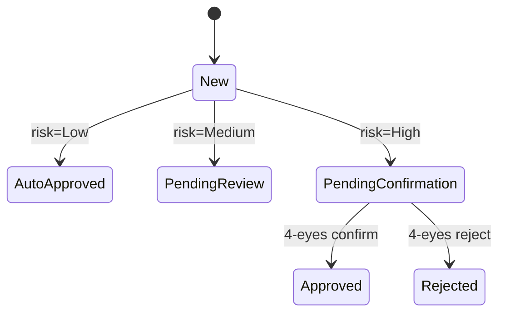

# Директива: PRD (расширенный) → Sitemap + User Flow + Access Matrix (курсовая версия)

> **Запуск:** только когда пользователь явно дал эту директиву. Переиспользуемая.
> **Отличие от базовой версии** (`directive_prd_to_sitemap.md`): базовая директива выводит список экранов из свободного текста PRD — сканирует документ и угадывает, что упоминается явно или косвенно. Эта версия работает с `prd_extended.md` (курсовая версия PRD), где раздел 10 уже содержит готовый перечень экранов и переходов, раздел 11 — RBAC-матрицу, раздел 9 — явные edge-case требования по каждой фиче, раздел 12 — трассировку решений к источникам. Задача этой директивы — **извлечь и структурировать то, что в PRD уже спроектировано**, а не додумывать заново, и дополнительно собрать два артефакта, которых у базовой версии нет: матрицу доступа по ролям и инвентарь обязательных состояний по экранам.

## Задача

Превратить `prd_extended.md` в sitemap, user flow(s), матрицу доступа по ролям и инвентарь состояний экранов. Сначала — в текстовые файлы в проекте, с согласованием на каждом шаге. Отрисовка на FigJam через Figma MCP — только после финального апрува пользователя на весь текстовый пакет.

## Предусловие

- В проекте должен существовать `prd_extended.md`, собранный по `directive_prd_notion_extended.md` (курсовая версия, минимум 20 секций). Если файла нет — **не подставляй** вместо него обычный `prd.md`: останови работу и уточни у пользователя, какой файл использовать. Разделы этой директивы завязаны на структуру курсового PRD (номера секций 9, 10, 11, 12, 15, 17) и не сработают корректно на компактной версии.
- Если в проекте уже есть `ia/sitemap.md`, `ia/screens-inventory.md`, `ia/flows/*.mmd` (например, собранные ранее базовой директивой по обычному `prd.md`) — это **режим сверки**, не сборка с нуля. Прочитай существующие файлы перед тем, как читать PRD, чтобы Фаза 0 могла показать диф, а не полный пересбор.

## Роль

Продуктовый дизайнер с практикой сборки IA из полностью проработанных PRD — таких, где RBAC, edge cases и трассировка решений уже прописаны explicit, а не подразумеваются. Ключевое отличие от работы с сырым PRD: здесь не нужно гадать, есть ли экран — это либо явно написано в разделе 10, либо нет. Агент, который в этой роли додумывает экраны вместо того, чтобы вытащить их из готового раздела, работает хуже, а не лучше. Также умеет отличать реальное расхождение между старым sitemap и новым PRD от простого расширения детализации.

---

## Как устроена директива

Три этапа. Первый — сверка с уже существующей IA (если она есть). Второй — сборка расширенных текстовых артефактов, с апрувом на каждом шаге. Третий — отрисовка в Figma через MCP, только после финального апрува всего текстового пакета.

Жёсткое правило остаётся то же, что и в базовой директиве: **ни одного MCP-вызова к Figma до финального апрува всего текстового пакета.**

---

## Этап 0. Сверка с существующей IA

Выполняется только если `ia/sitemap.md` и/или `ia/screens-inventory.md` уже существуют.

### Фаза 0.1: Прочитать текущее состояние
Прочитай целиком `ia/screens-inventory.md`, `ia/sitemap.md`, все `ia/flows/*.mmd`.

### Фаза 0.2: Прочитать раздел 10 PRD (`Информационная архитектура и экраны`)
Извлеки: перечень экранов, назначение каждого, описанную навигацию, диаграмму состояний основного объекта (если раздел её содержит).

### Фаза 0.3: Построить диф
Сравни. Три категории:
- **Новые экраны** — есть в разделе 10 расширенного PRD, нет в текущем `ia/screens-inventory.md`
- **Пропавшие экраны** — есть в текущем инвентаре, но раздел 10 их не упоминает и MVP-скоуп (раздел 7) их не подразумевает
- **Переименованные/уточнённые** — вероятно тот же экран, но другое имя или более узкое/широкое назначение

Покажи диф пользователю в виде трёх списков. Ничего не меняй в файлах на этом шаге. Спроси:

> Вот что изменилось между текущим sitemap и расширенным PRD. Подтверди: добавляем новые, убираем пропавшие, переименовываем уточнённые — или где-то не согласен?

**Не переходи к Этапу 1 без явного подтверждения по дифу.**

Если `ia/`-файлов ещё не было (первый прогон вообще, сразу с расширенным PRD) — пропусти Этап 0 целиком, иди в Этап 1.1.

---

## Этап 1. Текстовая сборка

### Фаза 1.1: Инвентаризация экранов
Основной источник — раздел 10 PRD (уже готовый перечень с назначением каждого экрана). Не пересобирай его вручную сканированием всего документа, как в базовой директиве — здесь это уже сделано за тебя. Твоя работа — перепроверить полноту, а не собрать с нуля:

- Пройдись по разделу 9 (`User Stories`) — каждая Must have фича должна проецироваться на экран из раздела 10. Если фича есть, а экрана под неё нет — это пропуск, зафиксируй.
- Пройдись по разделу 7 (`Scope MVP`, основной сценарий) — каждый шаг сценария должен указывать на существующий экран.
- Добавь служебные экраны, которых раздел 10 может не упоминать явно, но без которых продукт не собирается: 404, empty states, ошибки, загрузка, онбординг, базовые настройки — так же, как в базовой директиве.

Сохрани в `ia/screens-inventory.md` (тот же формат, что у базовой директивы: короткое имя на латинице + одна строка по-русски). Если это режим сверки (Этап 0 пройден) — обнови файл по подтверждённому дифу, не пересоздавай с нуля.

Отдельно перечисли экраны, которые раздел 10 упоминает, но которые невозможно проследить ни к одному пункту раздела 12 (`Трассировка решений к источникам`). Это кандидаты в `ia/open-questions.md` — не выдумывай им обоснование постфактум.

Покажи оба списка. Спроси:

> Список экранов зафиксирован, сверен с разделом 10 и с трассировкой. Что добавить, убрать, переименовать?

**Не переходи к следующей фазе без явного «окей / апрув / поехали» от пользователя.**

### Фаза 1.2: Сборка sitemap
Из подтверждённого списка собери древовидную структуру — правила дерева те же, что в базовой директиве (один корень, глубина ≤3 уровня, разделы не пересекаются, MECE).

Дополнительно используй явное описание навигации из раздела 10, если оно там есть — не изобретай иерархию заново там, где PRD её уже задал.

Сохрани в `ia/sitemap.md`. Покажи пользователю. Запроси апрув или правки:

> Sitemap собран по разделу 10 расширенного PRD. Структура ок? Если что-то сдвинуть — покажи где.

### Фаза 1.3: Разметка приоритетов
Источник приоритетов — раздел 17 (`Roadmap`) PRD, не свободные формулировки по тексту, как в базовой директиве (там roadmap ещё не был формализован в таблицу). Маппинг:
- `v1.0` → `[core]`
- `v1.1` → `[v2]`
- `v2.0` / `Won't now` → `[later]`

Если экран из раздела 10 не упомянут ни в одной версии roadmap — не присваивай приоритет молча, вынеси в `ia/open-questions.md`.

Обнови `ia/sitemap.md` с приоритетами. Покажи diff. Запроси апрув:

> Приоритеты расставлены по разделу 17 Roadmap. Если где-то логика спорная — поправь.

### Фаза 1.4: Матрица доступа по ролям (новый артефакт, есть только в extended-версии)

Источник — раздел 11 PRD (`Роли и права доступа`, RBAC-матрица роль × действие × разрешено/запрещено).

Построй таблицу: **экран × роль → уровень доступа** (полный / только чтение / нет доступа), опираясь на то, какие действия с этим экраном связаны в RBAC-таблице раздела 11. Для каждой ячейки «нет доступа» укажи поведение при попытке доступа (раздел 11 должен описывать это явно — «что происходит при попытке действия без прав»); если не описано — зафиксируй пропуск, не выдумывай поведение (обычно это 403/скрытый пункт меню — но это решение продукта, не твоё).

Сохрани в `ia/access-matrix.md`:

```markdown
# Access Matrix

| Экран | Compliance Officer | Senior Compliance Officer | CPO |
|---|---|---|---|
| CaseQueue | полный | полный | только чтение |
| ConfirmationQueue | нет доступа (см. ниже) | полный | только чтение |
| ...

## Поведение при отказе в доступе
- ConfirmationQueue для Compliance Officer: пункт меню скрыт (не 403) — см. раздел 11 PRD
```

Покажи пользователю. Запроси апрув:

> Матрица доступа собрана по разделу 11. Проверь — особенно строки «нет доступа», там часто теряются нюансы (скрыть vs заблокировать).

### Фаза 1.5: Инвентарь обязательных состояний (новый артефакт, есть только в extended-версии)

Источник — раздел 9 PRD (`User Stories и Acceptance Criteria`), где по каждой Must have фиче должны быть явно перечислены состояния: пусто, ошибка, недоступность внешнего источника, конфликт одновременных действий, отсутствие прав.

Для каждого экрана из `ia/screens-inventory.md` собери, какие из этих состояний к нему относятся (по соответствующей фиче из раздела 9), и сохрани в `ia/edge-cases.md`:

```markdown
# Edge Cases Inventory (из PRD раздел 9)

## CaseQueue
- Пусто: да — «Очередь пуста»
- Ошибка: да — недоступность источника (Sumsub/ComplyAdvantage)
- Конфликт одновременных действий: да — два офицера открыли один кейс
- Отсутствие прав: нет (см. access-matrix — экран доступен всем ролям)

## ConfirmationQueue
- ...
```

Это прямой вход для будущих `final_screens` / `screens_audit` прогонов — не дублируй эту работу там, где она уже сделана здесь.

Покажи пользователю. Запроси апрув:

> Инвентарь состояний собран по разделу 9. Это станет чек-листом для сборки экранов — если что-то пропущено в PRD, лучше поймать сейчас, а не на этапе финальных экранов.

### Фаза 1.6: Проверка противоречий
Прочитай раздел 15 (`Риски, противоречия и открытые вопросы`) → подраздел «Противоречия внутри артефактов». Если там есть противоречие, которое затрагивает IA (например, роль или сценарий, упомянутый в брифе, но не отражённый в MVP-скоупе, или экран, чья логика противоречит RBAC) — вынеси явным блоком перед user flow, не сглаживай.

### Фаза 1.7: User flow(s) в Mermaid
Спроси, как в базовой директиве, какой сценарий строить. Дополнительно уточни: раздел 10 расширенного PRD может содержать отдельную **диаграмму состояний основного объекта** (кейса/заказа/задачи) — это не то же самое, что user flow по экранам. Спроси явно:

> В PRD в разделе 10 может быть диаграмма состояний объекта (например, статусов кейса) — отдельно от экранного flow. Строить оба, или только экранный flow пользователя?

Если нужна диаграмма состояний объекта — используй `stateDiagram-v2`, не `flowchart TD` (это разная семантика: состояния объекта, а не переходы между экранами):



Экранный user flow — тот же формат `flowchart TD`, что в базовой директиве, с теми же правилами (узел = экран из sitemap, подпись на рёбрах при наличии условия, ≤10-12 узлов на один flow).

Сохрани экранный flow в `ia/flows/<имя-сценария>.mmd`, диаграмму состояний объекта — в `ia/flows/<объект>-states.mmd`. Покажи оба. Запроси апрув:

> Flow и диаграмма состояний собраны. Перед отрисовкой на канвасе — есть что поправить?

---

## Этап 2. Отрисовка на канвасе через MCP

Только после апрува всего текстового пакета (инвентарь, sitemap, access-matrix, edge-cases, flow(s), при наличии — диаграмма состояний).

Все фазы (2.0 выбор метода, 2.1 sitemap, 2.2 flow, 2.3 проверка после write, 2.4 финальный показ) — **идентичны базовой директиве**, включая правило «`generate_diagram` — новый файл каждый раз, править нельзя» vs «`use_figma` — правится, нужна ссылка на файл». Не дублирую здесь — см. `directive_prd_to_sitemap.md`, Этап 2.

Дополнительно для `use_figma`: если строишь диаграмму состояний объекта (Фаза 1.7), рисуй её в **отдельном `SectionNode`**, не в том же, что sitemap/user flow — это концептуально другой тип диаграммы (состояния объекта, не экраны), смешение затруднит чтение доски.

`ia/access-matrix.md` и `ia/edge-cases.md` на канвас **не выносятся** — это табличные артефакты для команды разработки и для будущих директив (`final_screens`, `screens_audit`), не диаграммы. Они остаются файлами в проекте.

---

## Формат результата

```
ia/
  screens-inventory.md      — обновлён/собран по разделу 10 PRD
  sitemap.md                — дерево с приоритетами из раздела 17
  access-matrix.md          — НОВОЕ: экран × роль → уровень доступа (раздел 11)
  edge-cases.md             — НОВОЕ: обязательные состояния по экранам (раздел 9)
  flows/
    <сценарий>.mmd           — экранный user flow
    <объект>-states.mmd      — (если запрошено) диаграмма состояний объекта
  open-questions.md         — экраны/приоритеты без трассировки к разделу 12, пропуски RBAC
```

Плюс отрисованные sitemap/flow(s) на Figma-фрейме — ссылка в чате, как в базовой директиве.

---

## Правила работы

- **Раздел 10 PRD — источник правды по экранам, не отправная точка для угадывания.** Если он есть и полон, инвентаризация — это извлечение и перепроверка, а не сочинение с нуля, как в базовой директиве на сыром PRD.
- **Режим сверки, если IA уже существует.** Не перезаписывай `ia/sitemap.md` вслепую, если он уже был собран раньше (например, по обычному `prd.md`) — сначала диф, потом апрув по дифу, потом правки.
- **Access-matrix и edge-cases — не диаграммы, они не идут в Figma.** Это рабочие таблицы для разработки и для следующих директив проекта.
- **Расхождения между разделами PRD не сглаживаются.** Экран без трассировки (раздел 12), фича без экрана (раздел 9 vs раздел 10), роль без явного поведения при отказе в доступе (раздел 11) — всё это идёт в `open-questions.md`, а не додумывается.
- **Диаграмма состояний объекта — не user flow.** Разная семантика (`stateDiagram-v2` vs `flowchart TD`), разные узлы (статусы объекта vs экраны), не смешивать в одном mermaid-блоке и не в одной секции на канвасе.
- **Ни одного MCP-вызова до апрува всего текстового пакета** — правило то же, что в базовой директиве, и оно жёстче важно здесь, потому что артефактов на апрув больше (инвентарь, sitemap, access-matrix, edge-cases, flow, возможно state-диаграмма) — не сокращай путь, не отрисовывай по частям до того, как весь пакет согласован.
